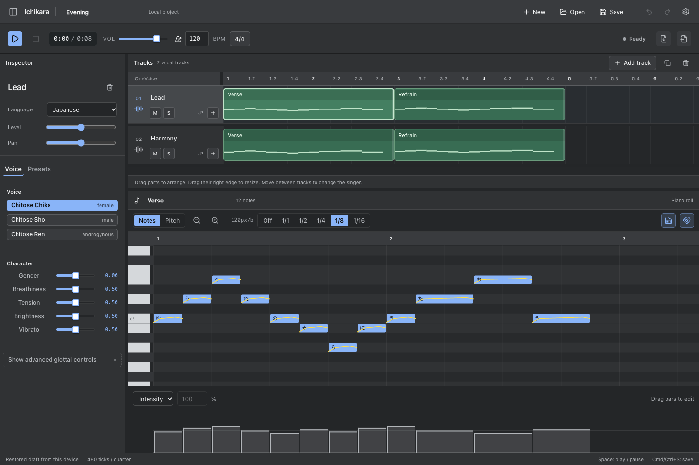
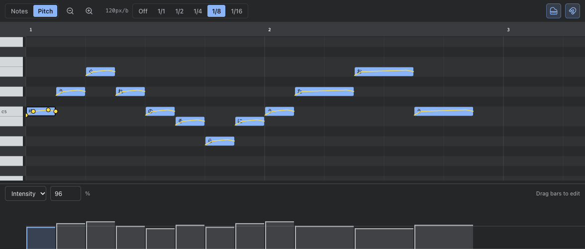

# Ichikara

[](https://www.npmjs.com/package/ichikara)
[](https://github.com/NellowTCS/Ichikara/actions/workflows/ci.yml)
[](LICENSE)

Ichikara is a song editor powered by OneVoice and a TypeScript singing-synthesis library.
Write a melody, add lyrics, and shape the voice without recording a voicebank.
The engine generates sound with an LF glottal source and a formant filter.

[Open the editor](https://nellowtcs.me/Ichikara) | [Documentation](https://nellowtcs.me/Ichikara/docs)



## Song editor

Arrange vocal parts across tracks, then select a part to edit its notes. Each
track has its own voice, language, level, pan, mute, and solo controls.

- Draw, move, and resize notes. Edit lyrics and phonemes in the inspector.
- Add pitch points and see the curves on unselected notes too.
- Draw intensity and velocity in the expression lane, or enter an exact value.
- Edit tempo and meter changes. Follow playback in either page or smooth mode.
- Resize the inspector, arrangement, expression lane, track headers, and rows.
- Undo song edits and recover the working draft after reloading the browser.



Save your work as `.ichi`. Native projects keep the tracks, parts, voices,
expression, and mix settings; older `.ichikara` files still open. You can also
import singing-synth scores and export the song as USTX or stereo WAV. Score
conversion retains tracks and note timing, but cannot carry every native setting
or the original region boundaries.

Settings are saved on this device, separately from the song. They include layout,
snap, note height, playback follow, selection color, rendering at 44.1 or 48 kHz,
and playback prebuffer. The editor runs in the browser; desktop packaging is still
under consideration.

See the [editor guide](Docs/docs/guide/editor.md) for controls and shortcuts.

## Library

```sh
npm install ichikara
```

The library supports Japanese, English, and Mandarin lyrics, three Chitose voice
presets, custom voice configurations, score conversion through utaformatix-ts,
and streaming playback through Web Audio. Synthesis is written in TypeScript and
does not require a native audio engine.

Render a phrase to WAV in Node:

```typescript
import { writeFileSync } from "node:fs";
import { renderScore, chitoseChika, encodeWav, type Score } from "ichikara";

const score: Score = {
  tempos: [{ tick: 0, tempo: 120 }],
  resolution: 480,
  notes: [
    { lyric: "こ", noteNum: 60, length: 480 },
    { lyric: "ん", noteNum: 62, length: 480 },
    { lyric: "に", noteNum: 64, length: 480 },
    { lyric: "ち", noteNum: 65, length: 480 },
    { lyric: "は", noteNum: 67, length: 960 },
  ],
};

const chunks = await renderScore(score, chitoseChika, "jp");
writeFileSync("hello.wav", Buffer.from(encodeWav(chunks)));
```

`renderScore` collects audio chunks; `streamScore` yields them as they become
available. Use `StreamPlayer` for browser playback. For multi-track songs,
`createProject`, `addTrack`, and `addPart` construct native documents, while
`streamProject` applies track placement, voice controls, mute/solo, gain, and pan.

- [Rendering and playback](Docs/docs/guide/renderer.md)
- [Native projects](Docs/docs/api/projects.md)
- [Import and export](Docs/docs/api/import-export.md)
- [Voice configuration](Docs/docs/api/voice-config.md)

## Development

Use Node 22.18+ or Node 24 and npm. CI checks Node 22 and 24. The CMUDict build
data is a Git submodule.

```sh
git clone https://github.com/NellowTCS/Ichikara.git --recurse-submodules
cd Ichikara
npm ci
npm run build -w Build
npm run dev -w Demo
```

`Build/` contains the library; `Demo/` contains the Svelte editor.

- `npm test` runs the library and editor unit tests.
- `npm run check` runs strict type checks, lint, unit tests, and a production build.
- `npm run build` builds both workspaces.

Compiler setup and dependency repairs are covered in
[Development checks](Docs/docs/development.md).

The documentation site is a separate npm project in `Docs/`:

```sh
cd Docs
npm ci
npm run dev
```

Run `npm run build` there to generate the site.

## License

MIT. See [LICENSE](LICENSE).
